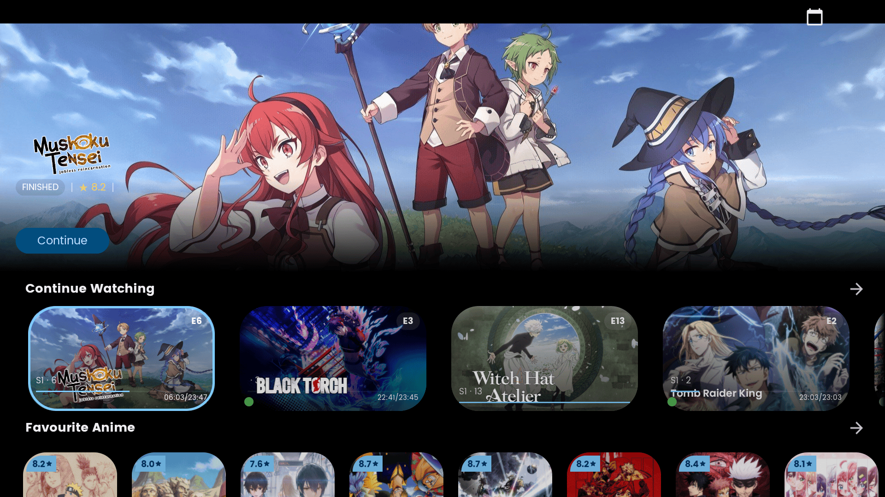

<div align="center">
  
  <h1>Sanin</h1>
  <p><strong>Discover. Watch. Track. — built for TV, works on phones and tablets.</strong></p>
  <p>
    <a href="https://discord.gg/QCc5xbgbsA"></a>
    <a href="https://t.me/+91YmT3cUqv5iNDRk"></a>
    
    
    
  </p>
</div>

## About

Sanin is an open-source Android app for discovering, watching, and tracking anime, movies, and TV shows. It is designed with Android TV and Fire TV in mind while remaining comfortable to use on phones and tablets.

Sanin builds on ideas and foundational work from [Dantotsu](https://github.com/itsmechinmoy/Dantotsu). Since then, it has undergone extensive independent development, with its own features, architecture, interface, playback experience, and dedicated TV-focused improvements.

<p align="center"></p>

## Description

- **Discover** anime, movies, and TV shows through curated shelves, catalogue browsing, search, and related titles.
- **Watch** supported content through separately installed third-party anime extensions and the built-in media player.
- **Track** progress with AniList, MyAnimeList, and Simkl.
- **Customize** the experience with themes, playback preferences, and layouts for touchscreens and TV remotes.

## Features

### Discovery and catalogue
- Discovery shelves for anime, movies, and TV shows.
- Anime catalogue and discovery sections supplied by compatible extensions where available.
- TMDB-powered browsing and metadata for movies and TV shows.
- Search, related titles, franchise browsing, trailers, and media details.
- Posters, backdrops, descriptions, ratings, genres, and other available metadata.

### Movies and TV shows
- Browse movies and TV shows using TMDB metadata.
- Explore title details, collections, related content, and available trailers.
- Track supported movie and TV activity through Simkl.

### Media player
- Media3 ExoPlayer playback engine.
- Playback gestures and remote-friendly controls.
- Subtitle support, including online subtitle providers where available.
- Playback speed, aspect ratio and resize modes, subtitle synchronization, and episode navigation.
- Server selection and controls designed for touch and D-pad use.
- Picture-in-Picture on compatible Android devices.

### Android TV and Fire TV
- D-pad and remote navigation throughout the TV experience.
- Visible focus states and focus-aware layouts.
- TV-oriented navigation, dialogs, and playback controls.
- Phone and tablet support alongside the TV interface.

### Tracking and accounts
- AniList integration for list management and episode progress.
- MyAnimeList integration for supported tracking actions.
- Simkl integration for supported anime, movie, and TV tracking.
- Account connection and progress synchronization through the respective services.

### Extensions
- Compatible third-party anime extensions provide streaming sources.
- Add extension repositories and install or update supported extensions within Sanin.
- Language filtering and source preferences where supported.
- Extensions are separate packages, independently developed and maintained by their authors.

### Customization and utilities
- Multiple accent palettes and theme variants.
- Configurable appearance, interface effects, and playback preferences.
- Notifications for supported airing and subscription activity.
- Backup and restore, app logging, and cache management.
- Deep links, profile and statistics views, and franchise browsing.

## Quick start

1. Download the appropriate phone or TV APK from [GitHub Releases](https://github.com/Shippun58/Orochimaru/releases).
2. Install it on your Android device, Android TV, or Fire TV device.
3. Open Sanin and connect the tracking services you use.
4. To watch anime through extensions, add a compatible extension repository and install an extension.
5. Browse, choose a title, and select an available source.

**Compatibility:** Sanin supports Android devices from API 21 onward. Android TV and Fire TV support depends on the device and its Android compatibility. Samsung TVs running Tizen do not install Android APKs.

## How extension playback works

```
User selects an episode
        ↓
Sanin looks up an installed compatible extension
        ↓
The extension resolves an available stream
        ↓
Sanin passes the stream URL and required headers to Media3
        ↓
The player handles playback
```

Extensions are separate from the Sanin app and communicate through the supported source interface. Availability and reliability depend on each extension and the website it uses.

## Building from source

```bash
git clone https://github.com/Shippun58/Orochimaru.git
cd Orochimaru
./gradlew tasks
```

Use the build tasks and SDK/JDK versions configured by the project. Build variants and output locations may change as development continues.

## Contributing

Bug reports, suggestions, and pull requests are welcome. Please include clear reproduction steps and specify whether an issue occurs on a phone, Android TV, or Fire TV.

## Acknowledgements

Sanin builds upon the original work of the [Dantotsu](https://github.com/itsmechinmoy/Dantotsu) project. Special thanks to its developers and contributors for the foundation and ideas that helped make Sanin possible. Sanin has since undergone extensive independent development, including its own features, architecture changes, interface, playback improvements, and dedicated Android TV experience.

Thanks also to open-source library developers, independent extension developers and maintainers, the teams behind [AniList](https://anilist.co), [MyAnimeList](https://myanimelist.net), [Simkl](https://simkl.com), and [TMDB](https://www.themoviedb.org), and everyone in the Sanin community who tests, reports issues, and shares feedback.

## License

Sanin is distributed under the **Unabandon Public License (UPL)**, which incorporates the terms of the GNU General Public License v3 (GPLv3). See the `LICENSE` file for details.

## Copyright and DMCA notice

Sanin does not host, upload, store, own, or distribute copyrighted episodes, movies, or TV content. Streaming sources, when available, are provided by third-party extensions that are separate from Sanin and independently developed and maintained. Sanin does not control the content, availability, or operation of those external sources.

For broken links, missing episodes, unavailable servers, source errors, or extension installation and update problems, contact the relevant extension developer or maintainer.

Trailers, clips, posters, backdrops, and metadata may be provided by TMDB or other third-party services, depending on the feature and source. Their respective rights remain with their copyright holders; Sanin does not claim ownership of that material.

For copyright concerns involving material directly maintained in the Sanin project, please report the matter through this GitHub repository. For material supplied by an external extension, website, or hosting provider, contact the relevant extension developer, website operator, or host.

Users are responsible for ensuring that their use of Sanin and any third-party extensions complies with applicable laws and the terms of the services they use.
